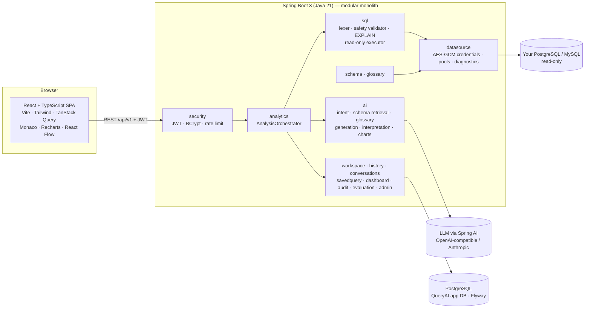

# QueryAI — Intelligent Text-to-SQL Analytics Platform


> **Live app:** _add your Render/Railway URL here after deploying (see [docs/DEPLOY.md](docs/DEPLOY.md))_ ·
> **Video:** `demo/queryai-demo.mp4` (record it with `scripts/demo/record-demo.mjs`)

QueryAI turns plain-English questions into **validated, read-only SQL**. It runs that SQL against your
**PostgreSQL or MySQL** database, explains the real result and recommends a chart. The SQL is always shown for review.

> “Show the top 10 customers by total spending this year, compare their spending with the previous year,
> calculate the percentage change, and identify customers whose spending declined by more than 15%.”

QueryAI works through that question in nine steps:

1. Identifies the intent (a ranking plus a period comparison).
2. Retrieves the relevant tables and foreign keys.
3. Applies your glossary definition of *spending*.
4. Generates dialect-correct SQL.
5. Validates it statically and with an `EXPLAIN` dry run.
6. Executes it in a read-only transaction.
7. Returns the real rows.
8. Explains them in plain language.
9. Records everything in query history.

---

## Contents
- [What's new in v2](#whats-new-in-v2)
- [AI setup (free options)](#ai-setup)
- [Accuracy benchmark](#accuracy-benchmark)
- [Deploy live](#deploy-live)
- [Features](#features)
- [Architecture](#architecture)
- [Quick start (Docker)](#quick-start-docker)
- [Local development](#local-development)
- [Configuration](#configuration)
- [Security model](#security-model)
- [API](#api)
- [Testing](#testing)
- [Project structure](#project-structure)
- [Verification status of this build](#verification-status-of-this-build)
- [Limitations and next steps](#limitations-and-next-steps)

## What's new in v2

| Feature | How it works |
|---|---|
| **Semantic schema search (pgvector)** | Every table is described (name, comment, columns, relationships) and embedded. Questions are embedded the same way and matched by cosine distance **inside PostgreSQL with pgvector's `<=>` operator** (falls back to in-app cosine on servers without the extension). Retrieval is *hybrid*: semantic similarity + lexical ranking + foreign-key neighbours. Embeddings come from the built-in `local-hash-512` model (offline, deterministic) or any OpenAI-compatible `/embeddings` endpoint (Ollama `nomic-embed-text`, OpenAI, Gemini). Explore → *Semantic search* shows the ranking; the AI pipeline trace says which engine was used. |
| **PII column masking** | Columns are classified automatically (email, phone, person name, address, postal code, date of birth, national ID, card, bank account, IP, credentials); admins can override any column or switch masking off per connection. Members below ADMIN receive masked values — also through aliases (`email AS contact`) and expressions over PII — and free-text cells are scrubbed for emails, card/phone numbers and SSN patterns. Masking is applied on the server **before** results reach the UI, the AI explanation, dashboards or CSV exports. Admins can *preview as analyst*. |
| **CSV upload** | Drag a CSV (or TSV) onto *Connections*. An RFC 4180 parser handles quotes, multi-line fields, BOMs and delimiter detection; column types (integer, decimal, boolean, date, timestamp, text) are inferred from **every** row (codes with leading zeros stay text). The file becomes a table in the workspace's own warehouse schema, exposed through a read-only *Uploaded files* connection, so it can be explored and asked about immediately. |
| **Accuracy benchmark in CI** | 40 questions (easy / medium / hard) with hand-verified gold SQL. The runner asks the live pipeline, executes both queries through QueryAI and compares result sets. CI checks every gold query on each push and runs the full live benchmark when a `GROQ_API_KEY` secret is present. |
| **Cinematic UI** | A scroll-driven three.js “Midnight Library” landing (procedural shelves, bloom, reflections, floating panels that turn a question into SQL, a chart and an insight), a floating navbar, four themes (Midnight · Crimson · Graphite · Light), an editorial *Ask AI* experience with question themes, muted SQL editor themes and animated charts using a colour-vision-validated palette. |
| **Guest access** | `QUERYAI_DEMO_PUBLIC=true` adds **Continue as guest** to the sign-in page: visitors open the starter workspace as an ANALYST (PII masked, cannot reconfigure it), owned by a separate admin. |

## AI setup

Any OpenAI-compatible endpoint works. Pick one and put it in `.env`, then `docker compose up -d backend`.

| Option | Cost | `.env` |
|---|---|---|
| **Groq** (recommended for laptops and deployment) | free tier | `OPENAI_API_KEY=gsk_…` · `OPENAI_BASE_URL=https://api.groq.com/openai` · `OPENAI_MODEL=llama-3.3-70b-versatile` |
| **Ollama** (fully local) | free | `OPENAI_API_KEY=ollama` · `OPENAI_BASE_URL=http://host.docker.internal:11434` · `OPENAI_MODEL=qwen2.5-coder:3b` (8 GB RAM) or `qwen2.5-coder:7b` |
| **OpenAI** | paid | `OPENAI_API_KEY=sk-…` · `OPENAI_MODEL=gpt-4o-mini` |
| **Anthropic** | paid | `QUERYAI_LLM_PROVIDER=anthropic` · `ANTHROPIC_API_KEY=…` |

Optional neural embeddings for semantic search (the built-in local embeddings work without this):
`QUERYAI_EMBEDDINGS_PROVIDER=openai`, `QUERYAI_EMBEDDINGS_URL=http://host.docker.internal:11434/v1/embeddings`,
`QUERYAI_EMBEDDINGS_MODEL=nomic-embed-text` (after `ollama pull nomic-embed-text`).

## Accuracy benchmark

```bash
node scripts/benchmark/run-benchmark.mjs --url http://localhost:13000      # needs a configured AI model
```

It writes `benchmark/results/latest.md` (summary table), `latest.json` (per question) and `badge.json`.
Metric: **execution accuracy** — a generated query is correct when it returns the same number of rows and every gold
column appears among its columns (multiset of values, numbers rounded to 2 decimals), the same rule as the in-app
evaluation harness.

<!-- BENCHMARK:START -->
**Run 1 — 30 Oct 2026 · `qwen2.5-coder:3b` via Ollama on an 8 GB MacBook (M3) · retrieval: hybrid, pgvector + local-hash-512**

| Metric | Value |
|---|---|
| Execution accuracy (40 questions) | **45.0%** (18/40) |
| — easy (12) | 75.0% |
| — medium (16) | 50.0% |
| — hard (12) | 8.3% |
| Generated SQL that executed | 90.0% |
| Answers rescued by self-repair | 6 |
| Median generation time | 16.7 s |

A 3-billion-parameter model running locally is the floor, not the target: most misses are multi-join or
multi-filter questions. Re-run with a larger model (e.g. Groq `llama-3.3-70b-versatile`) and paste the new
`benchmark/results/latest.md` here; the CI `benchmark` job does this automatically once `GROQ_API_KEY` is set.
<!-- BENCHMARK:END -->

## Deploy live

One container serves the UI and the API (`Dockerfile` at the repo root). See **[docs/DEPLOY.md](docs/DEPLOY.md)**:
Render (free, `render.yaml` blueprint — one click) or Railway (`railway.json`).

## Features

| Area | What you get |
|---|---|
| **AI Query Studio** | A multi-panel workspace with five parts:<br>• a schema tree, saved queries and conversation history<br>• a chat with example questions, follow-ups, clarification requests and pipeline timing<br>• a Monaco SQL editor with autocomplete, Validate/Run buttons and named parameters<br>• a results panel with a paginated, sortable and filterable table, column picker and CSV export<br>• charts (bar, line, pie, scatter, metric) and a result summary |
| **Text-to-SQL pipeline** | Intent analysis → schema retrieval (ranked tables plus their FK neighbours) → glossary retrieval → SQL generation → validation, with one automatic **self-repair** that feeds the validation errors back to the model → read-only execution → interpretation grounded in the returned rows → chart recommendation. |
| **Validation** | Dependency-free SQL lexer and safety validator: single statement, SELECT/WITH only, no DML/DDL/locking/`INTO`, blocked dangerous functions (`pg_sleep`, `pg_read_file`, `dblink`, `query_to_xml`, `SLEEP`, `LOAD_FILE` and others), system-catalog blocking, schema-scoped table authorisation, MySQL executable comments. This is followed by a database `EXPLAIN` dry run, which catches syntax errors and unknown columns and enforces cost limits. |
| **Connections** | Add, edit, remove and test PostgreSQL and MySQL connections. Diagnostics run step by step: host policy → DNS → TCP → auth → probe → schema. You can also refresh the schema, preview sample rows and set per-source row and time limits. |
| **Schema explorer** | Tables, columns, types, PKs, FKs, indexes and row estimates, with full-text search. Includes an interactive **ER diagram** (React Flow), editable column and table descriptions, and a **business glossary**. |
| **History & feedback** | Every question and execution is recorded: generated and executed SQL, validation and execution status, runtime, errors and model. You can search, filter, paginate, re-run, save, and give thumbs up/down. |
| **Saved queries** | Folders, rename/edit, duplicate, delete, **SQL version history with restore**, parameterised **templates** (`:start_date`) and private or workspace sharing. |
| **Dashboards** | Multiple dashboards with query-backed widgets (bar/line/pie/scatter/metric/table). Widgets are drag-and-resize, the layout is persisted, and widgets execute live. Sharing is permission-aware: shared dashboards can only use shared queries. |
| **Workspaces & admin** | Workspace roles (Owner/Admin/Analyst/Viewer), membership management, per-data-source grants, monthly AI quotas, audit logs, platform admin (users, roles, enable/disable, quotas). |
| **Evaluation** | A benchmark of questions with reference SQL. Execution accuracy is measured by comparing **real result sets**, and run history is tracked per model. |
| **Home dashboard** | Connected sources, queries in the last 30 days, success rate, average execution time, AI usage against quota, recent queries and activity. These are **measured values only**; the landing page's sample chart is labelled as illustrative. |

QueryAI never fabricates results. If the LLM is unavailable, AI features say so (HTTP 503 `LLM_NOT_CONFIGURED`) and manual SQL keeps working. If an explanation cannot be generated, a factual “system summary” is shown instead and labelled as such.

## Architecture



**Request flow for `POST /api/v1/analytics/analyze`**

1. **Authorise.** Check the workspace role, any per-source grant and the monthly AI quota.
2. **Intent analysis** (LLM, structured output): metrics, dimensions, filters, time range and keywords.
3. **Schema retrieval:** a lexical relevance ranking of tables, plus their foreign-key neighbours, rendered as compact DDL with descriptions.
4. **Glossary retrieval:** the business definitions that apply.
5. **SQL generation** (LLM, structured output validated with Bean Validation). The prompt includes the dialect rules, the schema, the glossary, the conversation so far and the intent.
6. **Validation.** Static safety and authorisation checks, then `EXPLAIN` with a cost check. On failure the errors are sent back to the model once, and it repairs the SQL.
7. **Execution:** `NamedParameterJdbcTemplate` inside an enforced read-only transaction, with a statement timeout and a row cap.
8. **Interpretation** of the returned rows (LLM) and a deterministic chart recommendation.
9. **Persistence:** query history, the conversation turn and an audit event.

Application persistence (PostgreSQL + Flyway) is completely separate from connected business databases.

## Quick start (Docker)

Requirements: Docker with Compose v2.

```bash
cp .env.example .env          # add OPENAI_API_KEY (or set QUERYAI_LLM_PROVIDER=anthropic + ANTHROPIC_API_KEY)
docker compose up --build
```

| URL | What |
|---|---|
| http://localhost:13000 | QueryAI web app |
| http://localhost:18080/swagger-ui.html | OpenAPI / Swagger UI |
| http://localhost:18080/actuator/health | Health check |

With `QUERYAI_DEMO_ENABLED=true` (the default in `.env.example`), first start sets up a ready-to-explore environment:

- **Sign-in:** the account **analyst@queryai.app / QueryAI@2026**.
- **Workspace:** *Acme Commerce Analytics*.
- **Connections:** two, to the bundled e-commerce database: *E-commerce (PostgreSQL)* and *E-commerce (MySQL)*.
- **Seeded content:** a business glossary, saved queries (including a parameterised template), a shared *Executive overview* dashboard and five evaluation cases.

The sample database contains 600 customers, 74 products in 20 categories, about 7,100 orders, about 14,000 order items, payments, reviews, warehouses and inventory, from Jan 2024 to Oct 2026. It is generated deterministically by `database/generator/generate-demo-data.mjs`. QueryAI connects to it as `queryai_reader`, a **SELECT-only role**.

Without an LLM key the app still works. You can connect databases, explore schemas, write and run SQL, save queries and build dashboards. Only natural-language questions are disabled, and a banner explains why.

## Local development

```bash
# 1. databases (or use your own PostgreSQL)
docker compose up -d postgres mysql

# 2. backend (Java 21, Maven 3.9)
cd backend
OPENAI_API_KEY=sk-... QUERYAI_DEMO_ENABLED=true mvn spring-boot:run

# 3. frontend (Node 20+)
cd frontend
npm install
npm run dev            # http://localhost:5173, proxies /api to :8080
```

Any OpenAI-compatible endpoint works. For example, a local Ollama instance:

```bash
OPENAI_BASE_URL=http://localhost:11434 OPENAI_API_KEY=ollama OPENAI_MODEL=qwen2.5-coder:14b mvn spring-boot:run
```

## Configuration

All settings are environment variables (see `backend/src/main/resources/application.yml`).

| Variable | Default | Purpose |
|---|---|---|
| `QUERYAI_DB_URL` / `_USERNAME` / `_PASSWORD` | `jdbc:postgresql://localhost:5432/queryai` | Application database |
| `QUERYAI_LLM_PROVIDER` | `openai` | `openai` (any OpenAI-compatible API) or `anthropic` |
| `OPENAI_API_KEY`, `OPENAI_BASE_URL`, `OPENAI_MODEL` | –, `https://api.openai.com`, `gpt-4o-mini` | OpenAI-compatible provider |
| `ANTHROPIC_API_KEY`, `ANTHROPIC_MODEL` | –, `claude-sonnet-4-5` | Anthropic provider |
| `QUERYAI_JWT_SECRET` | dev value | HS256 signing secret, **≥ 32 bytes** — set in production |
| `QUERYAI_JWT_TTL_MINUTES` | `480` | Token lifetime |
| `QUERYAI_CREDENTIAL_KEY` | dev value | Base64 32-byte AES key for data-source passwords — set in production |
| `QUERYAI_CORS_ORIGINS` | `http://localhost:5173,http://localhost:3000` | Allowed browser origins |
| `QUERYAI_AUTH_RATE_LIMIT` / `QUERYAI_AI_RATE_LIMIT` | `20` / `30` per minute | Login/register per IP; AI calls per user |
| `QUERYAI_BLOCKED_HOSTS` | cloud metadata hosts | Connection targets that are always refused |
| `QUERYAI_AI_SEND_RESULT_SAMPLES` | `true` | Send up to 30 result rows to the LLM for explanations; set `false` for metadata only |
| `QUERYAI_DEMO_ENABLED` | `false` | Create the sample account and connections |
| `QUERYAI_DEMO_PUBLIC` | `false` | Guest access: one-click sign-in to the starter workspace as an ANALYST |
| `QUERYAI_EMBEDDINGS_PROVIDER` | `local` | `local` (built-in), `openai` (OpenAI-compatible `/embeddings`), `none` |
| `QUERYAI_EMBEDDINGS_URL` / `_MODEL` / `_API_KEY` | – | Endpoint for `openai` embeddings |
| `QUERYAI_WAREHOUSE_ENABLED` | `false` | Enable CSV uploads |
| `QUERYAI_WAREHOUSE_URL` / `_USERNAME` / `_PASSWORD` | app database | PostgreSQL that receives uploads (admin login) |
| `QUERYAI_WAREHOUSE_READER_USERNAME` / `_PASSWORD` | `queryai_reader` | Read-only role used to query uploads |
| `QUERYAI_WAREHOUSE_BOOTSTRAP_DEMO` | `false` | Load the sample dataset into the warehouse on first start (single-database hosting) |
| `QUERYAI_MAX_UPLOAD_MB` / `QUERYAI_MAX_UPLOAD_ROWS` | `25` / `250000` | Upload limits |

## Security model

- **Authentication:** BCrypt (cost 12) password hashes. HS256 JWTs are issued and verified with Spring Security's resource server (Nimbus) and checked for issuer and expiry. A disabled account is rejected immediately. Login timing is equalised for unknown e-mail addresses.
- **Authorisation:** every resource is workspace-scoped, and a non-member gets 404 so the resource's existence doesn't leak.
  - **Roles:** Owner > Admin > Analyst > Viewer.
  - **Restricted data sources** require an explicit grant.
  - **Platform admins** are bootstrapped from the first registered account.
- **SQL safety (defence in depth):**
  1. a lexical validator (single read-only statement, forbidden keywords, functions and catalogs, schema-scoped table allow-list);
  2. an `EXPLAIN` dry run with cost limits;
  3. execution in a transaction with `SET TRANSACTION READ ONLY`, always rolled back;
  4. JDBC query timeouts and `maxRows`;
  5. read-only connection pools (`allowMultiQueries=false`, `allowLoadLocalInfile=false` on MySQL);
  6. a recommended SELECT-only database user. The sample uses `queryai_reader`.
- **Secrets:** data-source passwords are encrypted with AES-256-GCM (random IV, authenticated) and are never returned by the API.
- **SSRF and injection guards:**
  - Connection identifiers are restricted to a safe character set, so they can't inject JDBC URL parameters.
  - Link-local and administrator-blocked hosts are refused.
- **Abuse protection:** per-IP and per-user sliding-window rate limits, per-workspace monthly AI quotas, and an audit log of logins, failures, membership changes, connection changes, query execution and blocked queries.
- **Response hardening:** security headers and a strict CSP via nginx. CORS is allow-listed.

> The rate limiter trusts the first `X-Forwarded-For` hop set by the bundled nginx, which overwrites it. If you expose the backend directly, put it behind a proxy that does the same.

## API

The OpenAPI document is at `/v3/api-docs`, with Swagger UI at `/swagger-ui.html`. All endpoints are under `/api/v1`:

| Resource | Endpoints |
|---|---|
| Auth & profile | `POST /auth/register`, `POST /auth/login`, `GET /auth/me`, `GET/PUT /users/me`, `PUT /users/me/password` |
| Workspaces | `GET/POST /workspaces`, `GET/PUT/DELETE /workspaces/{id}`, `GET/POST /workspaces/{id}/members`, `PUT/DELETE /workspaces/{id}/members/{userId}`, `GET /workspaces/{id}/usage` |
| Connections | `GET/POST /datasources`, `GET/PUT/DELETE /datasources/{id}`, `POST /datasources/test`, `POST /datasources/{id}/test`, `GET/PUT /datasources/{id}/grants` |
| Schema | `GET /datasources/{id}/schema`, `POST /datasources/{id}/schema/refresh`, `GET /datasources/{id}/tables/{table}/preview`, `PUT /datasources/{id}/annotations`, `GET/POST/PUT/DELETE /datasources/{id}/glossary[/{termId}]` |
| SQL | `POST /sql/validate`, `POST /sql/execute` |
| Analytics | `POST /analytics/analyze`, `POST /analytics/generate`, `POST /analytics/interpret`, `GET /analytics/overview` |
| Conversations | `GET /conversations`, `GET/PATCH/DELETE /conversations/{id}` |
| History | `GET /history`, `GET /history/{id}`, `POST /history/{id}/feedback`, `POST /history/{id}/rerun` |
| Saved queries | `GET/POST /saved-queries`, `GET/PUT/DELETE /saved-queries/{id}`, `POST /{id}/duplicate`, `GET /{id}/versions`, `POST /{id}/versions/{v}/restore`, `POST /{id}/run` |
| Dashboards | `GET/POST /dashboards`, `GET/PUT/DELETE /dashboards/{id}`, `PUT /{id}/layout`, `POST /{id}/widgets`, `PUT/DELETE /{id}/widgets/{wid}`, `POST /{id}/widgets/{wid}/data` |
| Audit & admin | `GET /audit`, `GET /audit/me`, `GET /admin/stats`, `GET /admin/users`, `PUT /admin/users/{id}`, `GET /admin/workspaces`, `PUT /admin/workspaces/{id}/quota` |
| Evaluation | `GET/POST /evaluation/cases`, `DELETE /evaluation/cases/{id}`, `GET /evaluation/runs`, `POST /evaluation/run` |
| System | `GET /system/info` (public) |

Errors share one shape: `{timestamp, status, code, message, path, fieldErrors?}`.

## Testing

```bash
./"Run Tests.command"         # everything, inside Docker (nothing else to install); logs in logs/
cd backend && mvn verify      # unit tests (surefire) + Testcontainers integration tests (failsafe, needs Docker)
cd frontend && npm test       # Vitest + Testing Library
```

- **Backend unit tests (JUnit 5 + Mockito + AssertJ):**
  - SQL safety validator: 60+ adversarial and legitimate cases for PostgreSQL and MySQL.
  - AES-GCM cipher, host guard, JDBC URL building, rate limiter, parameter coercion.
  - Chart recommender, schema ranker (lexical + semantic), local embeddings, result comparator.
  - CSV parsing, type inference and identifier sanitising; PII detection and masking.
  - SQL generation prompts and repair, interpretation fallback, the orchestrator's main paths.
- **Backend integration tests** — the whole application against real databases (Testcontainers **PostgreSQL 16 + pgvector** and **MySQL 8.4**); only the LLM is mocked. One focused class per area:

  | Class | Covers |
  |---|---|
  | `AuthIT` | registration, login, JWT, validation errors, admin protection |
  | `ConnectionAndSchemaIT` | connection diagnostics, secrets never echoed, schema/keys/relationships, **pgvector** semantic search |
  | `SqlExecutionIT` | read-only execution, blocked writes/DDL/CTE writes/foreign schemas, EXPLAIN dry run, safe parameters |
  | `MySqlIT` | MySQL schema discovery, dialect queries, blocked writes, parameters |
  | `AiAnalysisIT` | question → SQL → real rows → chart → conversation → history; unsafe model output blocked; no-model message |
  | `AiQuotaIT` | **monthly AI quota**: enforced with 429, SQL unaffected, raising it restores AI, admin-only changes |
  | `SavedQueriesAndDashboardsIT` | versions, run, restore, duplicate, delete; dashboards with live widgets, layout, viewer rights |
  | `HistoryAndAuditIT` | history filters and paging, feedback, re-run; **audit log** contents, filters and access |
  | `WorkspaceIsolationIT` | **tenant isolation**: an outsider gets 404 on 20+ read paths and every write path; per-workspace upload schemas; member removal |
  | `CsvUploadIT` | **CSV upload end to end**: typed table → schema → SQL → AI → list → conflict/replace → delete; roles; PII in uploads |
  | `PiiMaskingIT` | detection, masking for analysts (also through aliases and expressions), admin preview, policies, AI answers |
- **Frontend tests (Vitest + Testing Library, jsdom):** theme system and selector, floating navbar, Ask AI hero, results table, semantic search, CSV upload, sign-in and registration pages, landing page, the Ask AI studio (answer panel kept separate from the conversation), and the API client.
- **CI (GitHub Actions):**
  - backend `mvn verify`;
  - frontend typecheck (app and tests), test and build;
  - a check that the sample database loads on PostgreSQL;
  - the accuracy benchmark (when `GROQ_API_KEY` is set);
  - Docker image builds, pushed to GHCR on `main`.

## Project structure

```
backend/                 Spring Boot (Java 21, Maven)
  src/main/java/com/queryai/
    common config security user workspace datasource schema
    ai sql analytics conversations history savedquery dashboard audit evaluation admin
  src/main/resources/db/migration   Flyway migrations (application DB)
  src/test/java                      unit tests + *IT integration tests
frontend/                React + TypeScript + Vite + Tailwind v4
  src/pages              Landing, Auth, Home, Studio, Connections, SchemaExplorer, History,
                         SavedQueries, Dashboards, DashboardView, Evaluation, WorkspaceSettings, Profile, Admin
  src/components         ui/ (design system), sql/, results/, schema/, layout/, landing/, studio/, upload/
  src/test               Vitest setup, API mock router and fixtures
database/
  demo/postgres|mysql    sample e-commerce schema, generated data, read-only grants
  generator/             deterministic data generator (Node)
  docker/postgres-init   creates the separate sample database in the Postgres container
docker-compose.yml       postgres + mysql + backend + frontend (nginx)
.github/workflows/ci.yml CI/CD
```

## Verification status of this build

This project was written in a sandbox that **could not reach Maven Central or the npm registry**. The full `mvn verify` and `npm run build` could therefore not be executed there. Run them locally or in CI as the first step after cloning. The following checks *were* run:

- **Database:** the Flyway migration and the PostgreSQL sample dataset (schema, about 32k rows, read-only grants) were loaded on PostgreSQL 16.
  - The example question's SQL and all seeded saved and evaluation queries ran successfully.
  - Writes via `queryai_reader` were rejected.
  - Order totals were reconciled with their line items.
- **Java:** the dependency-free core was compiled with `javac` and exercised by harnesses mirroring the unit tests (97 assertions, all passing). This core covers the SQL lexer and validator, AES-GCM cipher, host guard, JDBC URL builder, rate limiter, chart recommender, schema ranker, result comparator and parameter coercion.
- **Java (whole codebase):** all 142 Java sources (130 main, 12 test) parse with zero syntax errors. A dependency-free `javac` pass found no internal type inconsistencies across main and test code; the only errors came from the missing third-party jars.
- **Frontend:** all 44 TS/TSX files parse. A TypeScript 6 pass with third-party modules stubbed found no errors in the app's own types.
- **Config:** YAML, JSON and `pom.xml` are well-formed.

Not verified in that sandbox:

- MySQL loading.
- Compilation against the real third-party APIs: Spring Boot 3.5, Spring AI 1.0, Hibernate, React and library typings.
- A live LLM call.

## Limitations and next steps

- Rate limiting is in memory, which suits a single instance. For multiple replicas, move it to Redis.
- The built-in local embeddings are a hashed lexical-semantic model with a business thesaurus, not a neural model; configure an embeddings endpoint for neural semantic search.
- PII detection is name-based plus value patterns; it does not inspect every value of every column, and a determined analyst could still infer data through filters (e.g. `WHERE email LIKE 'a%'`). Use restricted connections for highly sensitive tables.
- Every viewer of a dashboard runs its widgets live. Result caching with a TTL would reduce load on the target database.
- The SQL validator is lexical, not a full parser. That's why execution also relies on read-only transactions and least-privilege database users.
